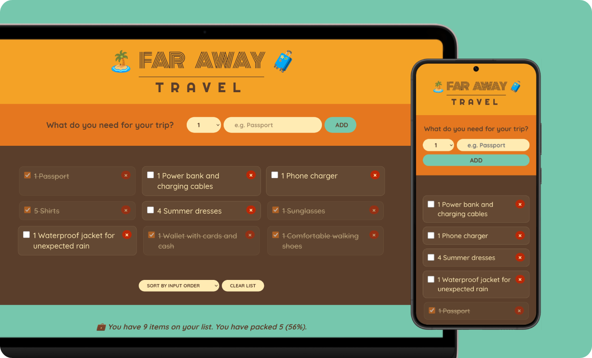
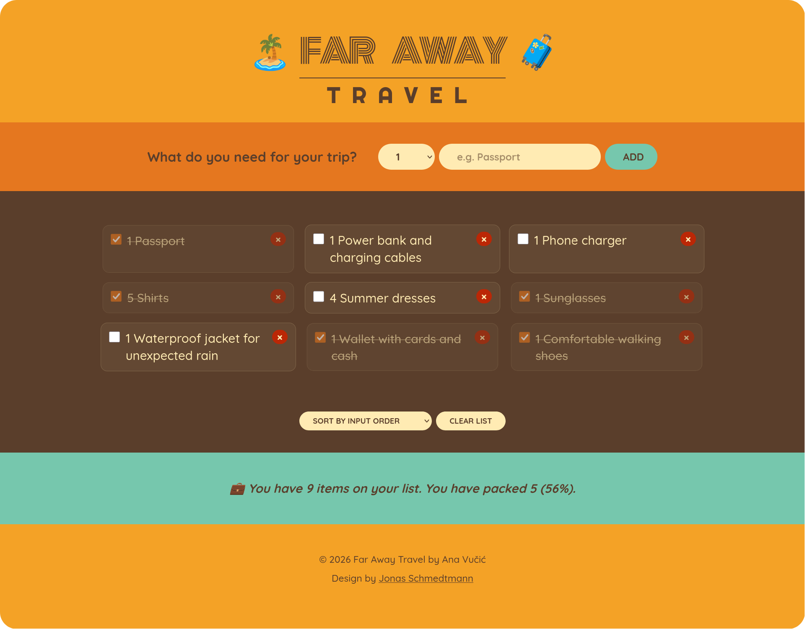
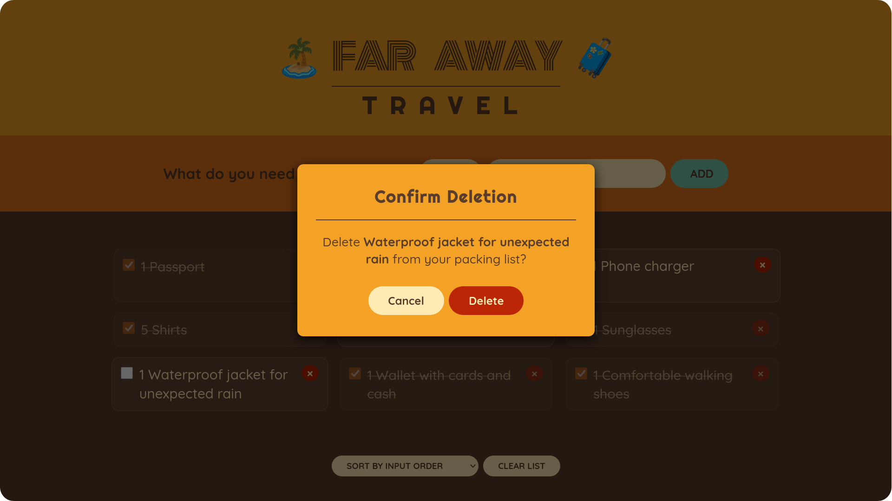
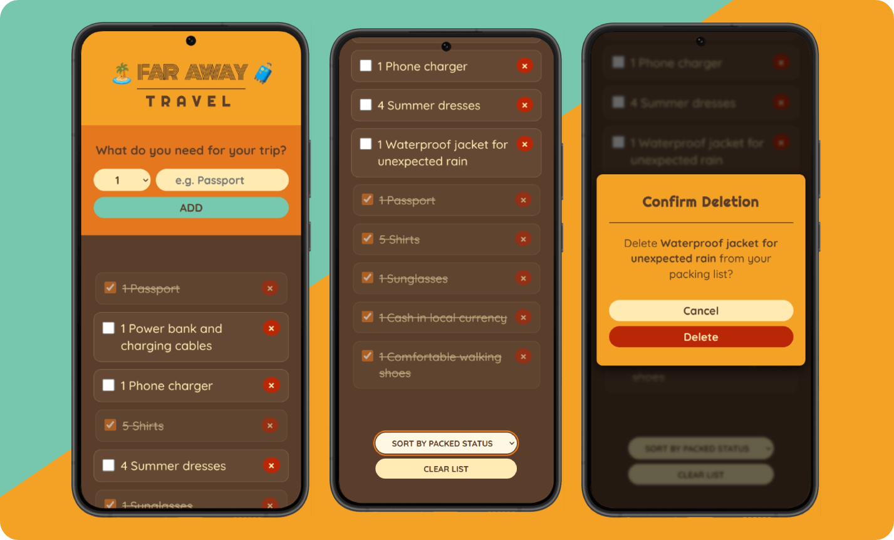

# 🧳 Far Away Travel List

A React exercise focused on state-driven UI, reusable dialogs, persistent storage, and accessibility.

     

---

## 🎯 Goal

Practice managing state while building a responsive, accessible packing-list UI with reusable components.

---

## 📸 Screenshots

  
<strong>View Screenshots</strong>

   

### Desktop View

### Confirmation Dialog

### Mobile View

---

## ✨ Features

- Form for adding items to the packing list
- Selectable quantities from 1 to 20
- Marking items as packed or unpacked
- Sorting by input order, packed status, or item name
- Live packing statistics and a completion message
- Individual item removal with a confirmation dialog managed through Context API
- List deletion with confirmation
- Responsive layout across desktop and mobile screens

---

## 🔧 Improvements & Enhancements

Compared to the initial exercise, this version includes:

- Semantic HTML structure
- Input validation through trimmed descriptions and a 100-character limit
- A custom hook encapsulating packing-list data and actions
- Data persistence using `localStorage`
- Memoized sorting with `useMemo`
- A reusable confirmation dialog for destructive actions
- Responsive design and refined packing-list item styling
- CSS organized into component-specific stylesheets
- Accessibility improvements

---

## 🧠 Key Learnings

- Synchronizing React state with browser storage
- Managing reusable dialogs through configuration and callbacks
- Deriving statistics from application state
- Memoizing derived data with `useMemo`

---

## 🤝 Accessibility

- Semantic markup (`header`, `main`, `section`, `fieldset`, `legend`)
- Accessible labels for sections, form controls, sorting options, individual delete buttons, and dialog actions
- Native `<dialog>` element with modal behavior and keyboard support; focus returns to the triggering control when the dialog closes
- `aria-haspopup="dialog"` on controls that open confirmation dialogs
- Decorative visuals hidden from screen readers where appropriate
- Visible focus styles for interactive controls
- Respect for reduced-motion preferences

---

## 🎨 UI & UX

- Mobile-first packing-list grid layout with adaptive columns
- Clear visual distinction between packed and unpacked items
- Immediate feedback on total items, packed items, and packing progress percentage
- A distinct completion message when all items are packed

---

## 🛠️ Tech Stack

- React
- JavaScript (ES6+)
- CSS (modular, mobile-first)
- Browser `localStorage` API

---

## 📒 Notes

An extended React exercise exploring state management, reusable components, data persistence, and accessibility in a responsive packing-list interface.

---
