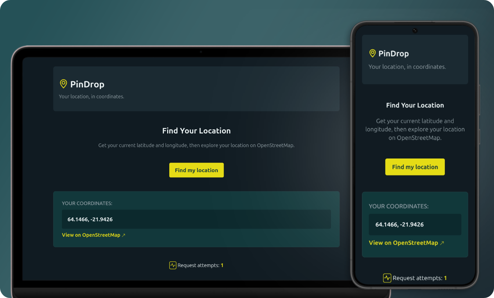
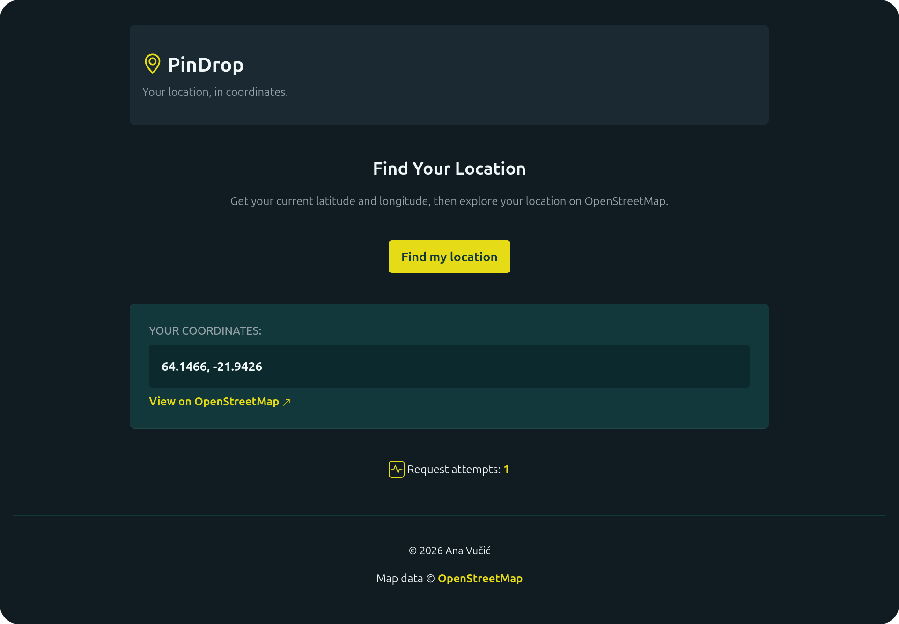
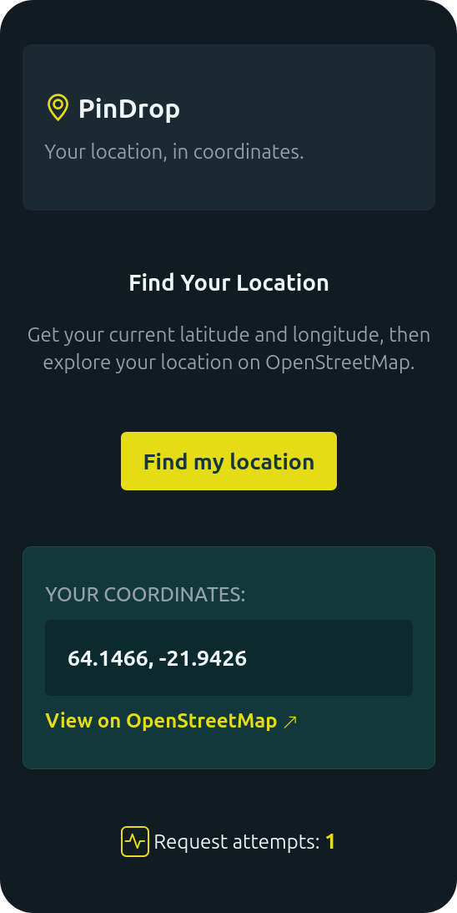

# 📌 PinDrop

A React exercise focused on the Geolocation API, conditional rendering, and accessible UI.

     

---

## 🎯 Goal

Practice React hooks by utilizing the browser Geolocation API and rendering components based on loading, error, and success states.

---

## 📸 Screenshots

  
<strong>View Screenshots</strong>

   

### Desktop View

### Mobile View

---

## ✨ Features

- One-click current location finder
- Latitude and longitude display with a direct link to an [OpenStreetMap](https://www.openstreetmap.org) map view
- Loading skeleton while obtaining coordinates
- Clear error message on failure
- Dynamic indicator showing the number of location request attempts

## 🔧 Improvements & Enhancements

Compared to the initial exercise, this version includes:

- An expanded `useGeolocation` hook to include live-region updates
- `Header` and `Footer` components for the app layout
- `GeoLocator` component for the main interface
- A dedicated live region for screen-reader announcements

## 🧠 Key Learnings

- Building custom React hooks
- Working with the browser Geolocation API
- Dynamically updating a centralized live region for better user experience

## 🤝 Accessibility

- Semantic HTML structure
- Live region announcements for loading, success, and error states
- Accessible color palette
- Decorative icons hidden from screen readers
- Respect for reduced-motion user preferences

## 🎨 UI & UX

- Responsive, mobile-first design
- Consistent visual hierarchy, spacing, and typography
- Clear visual feedback for user interactions and loading states

## 🛠️ Tech Stack

- React
- JavaScript (ES6+)
- CSS (mobile-first)
- Browser Geolocation API

---

## 📒 Notes

- Location access requires user permission and a secure context (HTTPS or localhost).
- Location availability and accuracy depend on browser support, device capabilities, and location settings.

---
