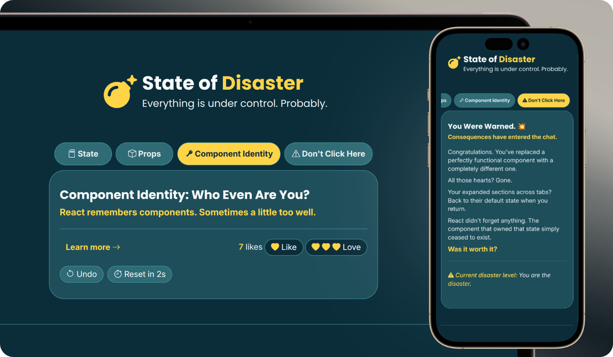
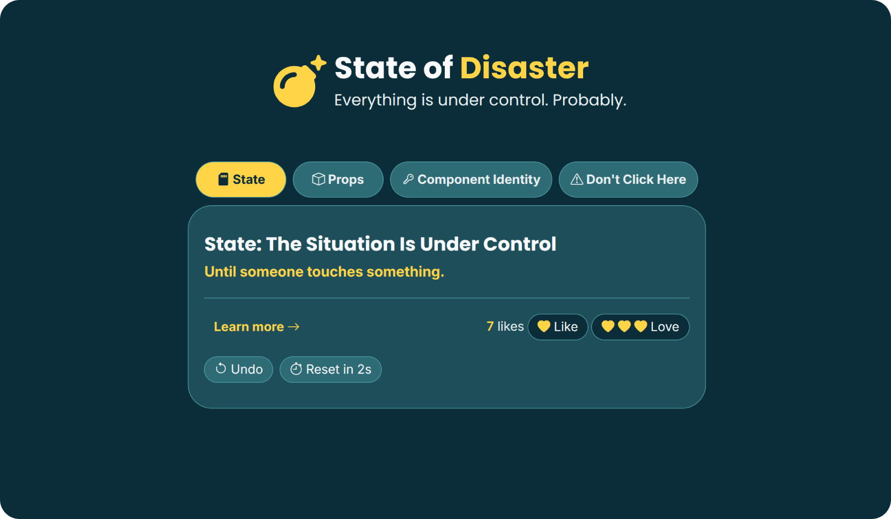
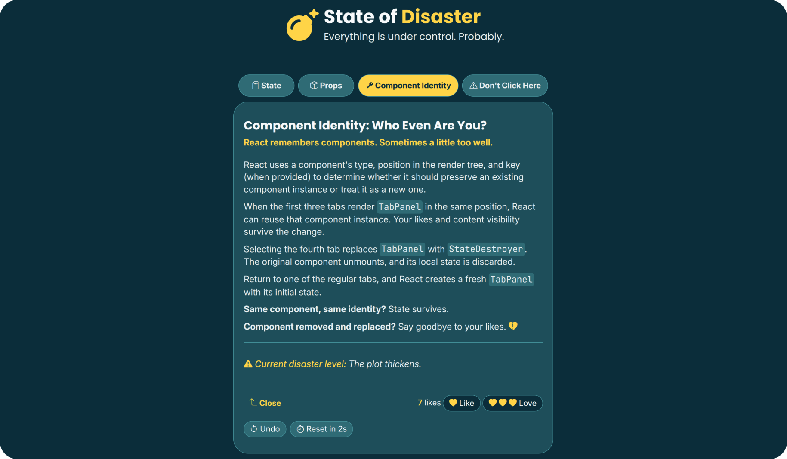
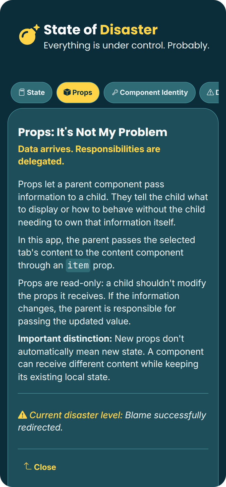

#  State of Disaster

> Everything is under control. Probably.

A React exercise exploring component identity, state preservation, and conditional rendering through interactive tabs.

     

---

## 🎯 Goal

Demonstrate how React preserves or resets component state based on component identity and position in the render tree.

---

## 📸 Screenshots

  
<strong>View Screenshots</strong>

   

### Default State (Desktop)

### Expanded Component Identity Panel (Desktop)

### Expanded Props Panel (Mobile)

---

## ✨ Features

- Four interactive tabs exploring React concepts, with dedicated content for each topic
- Expandable panels with component-local state
- Like and triple-like interactions with an accumulated counter and undo history
- Delayed reset with a two-second countdown that can be cancelled using Undo
- State-preservation and state-reset demonstrations through component identity

---

## 🔧 Improvements & Enhancements

Compared to the initial exercise, this version includes:

- Centralized tab configuration in `TAB_DATA`, including stable IDs, labels, icons, titles, subtitles, and content components
- Meaningful content across tabs:
  - **State:** how React preserves state across renders
  - **Props:** how components receive information
  - **Component Identity:** how component identity and position affect state preservation
  - **Don't Click Here:** what happens when the component owning the state is destroyed
- Undo history for likes and pending-reset cancellation
- Semantic, responsive, accessible design
- Keyboard-friendly tab navigation

---

## 🧠 Key Learnings

- How React associates state with a component's position and identity in the render tree
- Why changing a component's identity can reset its local state
- Managing related UI state and implementing Undo interactions
- Using refs and effect cleanup to manage delayed actions safely
- Structuring tab interfaces with reusable, data-driven components

---

## 🤝 Accessibility

- Semantic HTML and appropriate ARIA roles and attributes
- Keyboard navigation using `ArrowLeft`, `ArrowRight`, `Home`, and `End`
- Roving `tabIndex` to keep only the selected tab in the tab sequence
- Visible keyboard-focus indicators
- Descriptive accessible names for interactive controls
- Decorative icons hidden from assistive technologies
- Support for `prefers-reduced-motion` preferences

---

## 🎨 UI & UX

- Responsive, mobile-first design
- Consistent color palette, typography, and icons
- Clear visual feedback for selected tabs and interactive controls
- Consistent singular and plural labels for the like counter
- Distinct visual treatment for the final, deliberately destructive tab

---

## 🛠️ Tech Stack

- React
- JavaScript (ES6+)
- CSS3
- Bootstrap Icons

---

## 📒 Notes

This exercise shows how React uses component position and identity to preserve or reset state. The interactive tabs make these behaviors visible through expandable content, like history, and a cancellable delayed reset.

---
