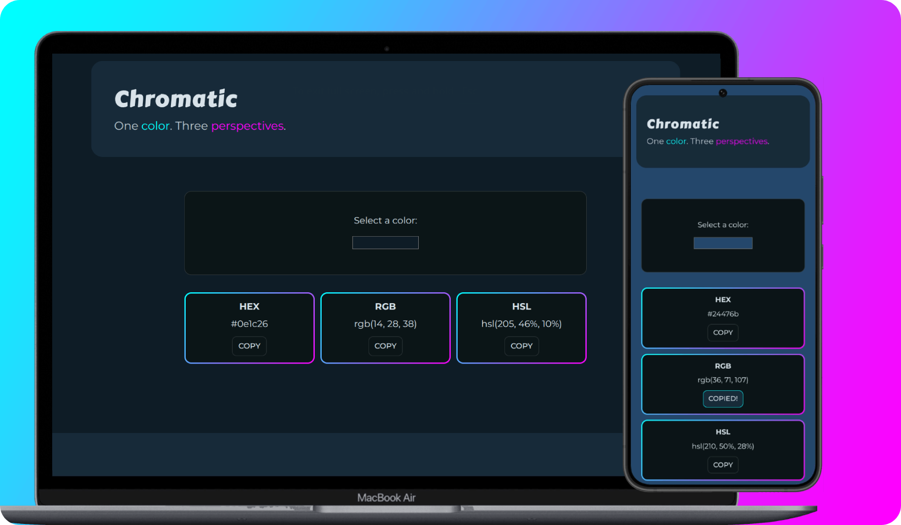
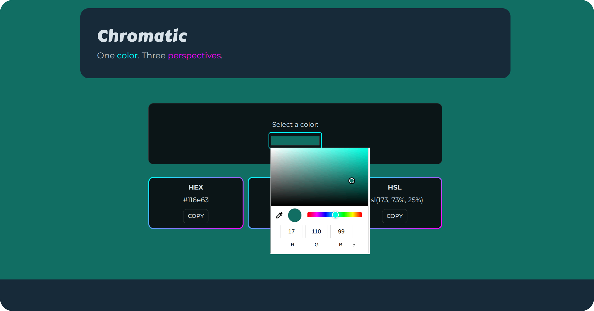
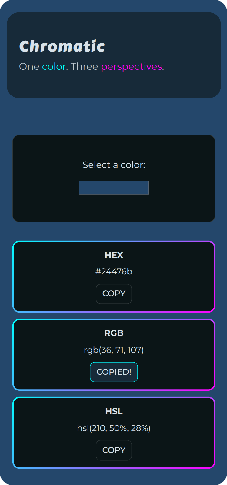

# 🪩 Chromatic

> One color. Three perspectives.

A React exercise in color conversion, color representation, and the browser's Clipboard API.

      

---

## 🎯 Goal

Build an interactive color tool that allows users to select a color and explore its hexadecimal, RGB, and HSL representations.

---

## 📸 Screenshots

  
<strong>View Screenshots</strong>

   

### Desktop View

### Mobile View

---

## ✨ Features

- Interactive color selection with a native HTML color picker
- Dynamic background updates based on the selected color
- HEX, RGB, and HSL color representations
- Copy-to-clipboard functionality for each color format
- Individual copy feedback and error handling

---

## 🔧 Improvements & Enhancements

Compared to the initial exercise, this version includes:

- The original background color changer expanded to a three-format color tool
- Reusable HEX-to-RGB and HEX-to-HSL conversion utilities
- Clipboard interactions using the Clipboard API
- Responsive layout and a custom dark color scheme
- Unit tests for both color conversion utilities using Vitest

---

## 🧠 Key Learnings

- Color representation and conversion between HEX, RGB, and HSL
- Working with the Clipboard API

---

## 🤝 Accessibility

- Semantic HTML, accessible grouping, and descriptive labels
- Keyboard-accessible color selection and copy controls
- Visible focus indicators
- Screen-reader announcements for clipboard operations
- Reduced-motion preference support

---

## 🎨 UI & UX

- Dark interface with cyan and magenta accents
- Responsive, mobile-first layout
- Consistent visual styling across interactive elements
- Clear visual feedback for copy operations

---

## 🛠️ Tech Stack

- React
- JavaScript (ES6+)
- JSX
- HTML5
- CSS3
- Vite
- Clipboard API
- Vitest

---

## 📒 Notes

Originally based on freeCodeCamp's Color Picker lab exercise, Chromatic evolved into an interactive color tool that explores three common color representations. The project provided an opportunity to practice React state management, reusable utility functions, browser APIs, accessibility, and unit testing.

---
