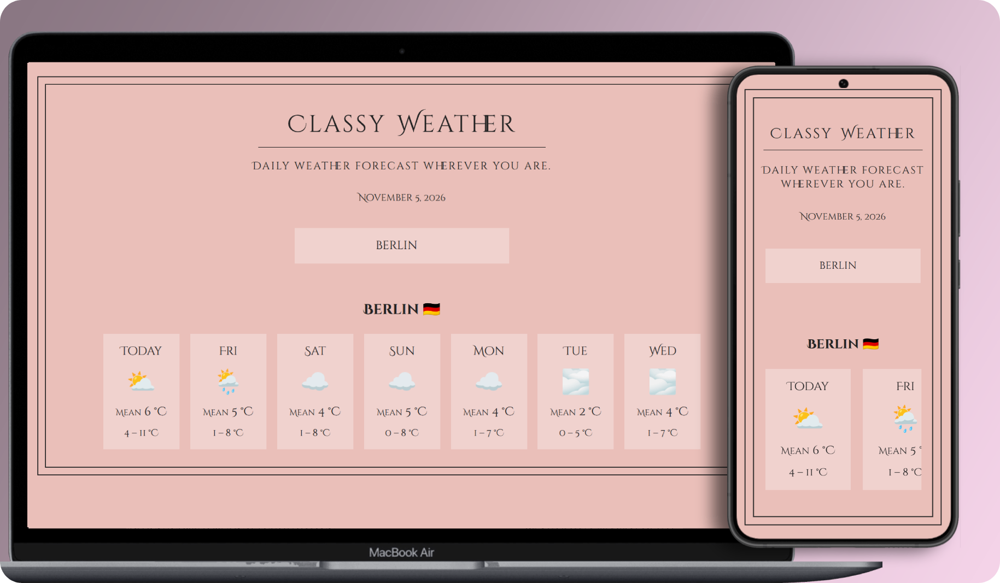
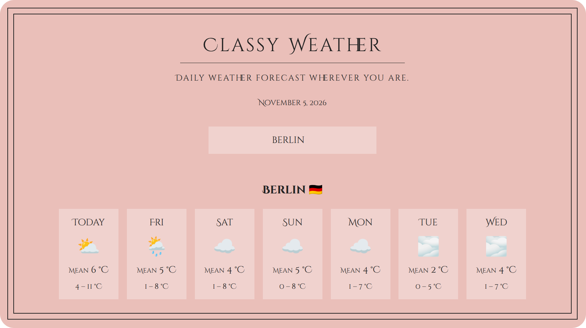
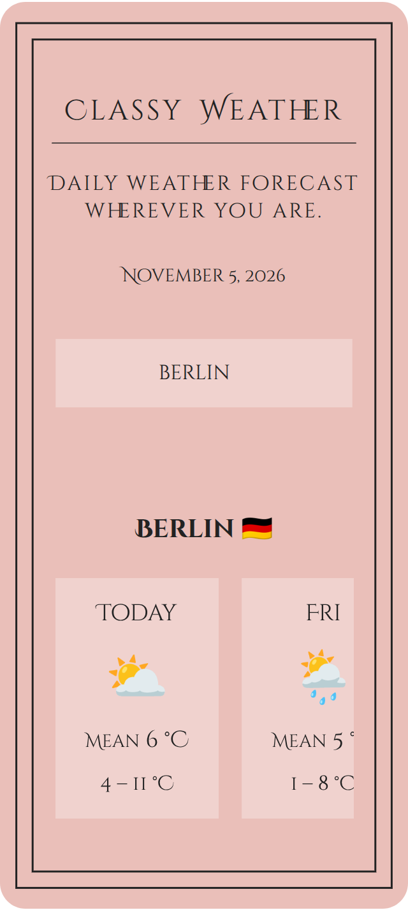

# 🌤️ Classy Weather

A class-based React weather app for searching locations and viewing daily weather forecasts.

     

---

## 🎯 Goal

Practice building React applications with class-based components, managing component state, working with lifecycle methods, and fetching data from external APIs.

---

## 📸 Screenshots

  
<strong>View Screenshots</strong>

   

### Desktop View

### Mobile View

---

## ✨ Features

- Location search and weather forecasts using [Open-Meteo](https://open-meteo.com/) APIs
- Daily weather conditions with minimum and maximum temperatures
- Last-searched location persistence using `localStorage`

---

## 🔧 Improvements & Enhancements

Compared to the initial exercise, this version includes:

- Modular component architecture with added `Header`, `Footer`, and `SearchBar` components
- Conversion and formatting utilities extracted into modules
- Current date display with localized formatting
- Daily mean temperature alongside minimum and maximum temperatures
- Responsive styling and horizontal forecast scrolling

---

## 🧠 Key Learnings

- Managing state and passing props with class-based components
- Using lifecycle methods to trigger data fetching and synchronize state with `localStorage`

---

## 🤝 Accessibility

- Semantic HTML structure with an accessible search form
- Screen-reader-only labels to distinguish temperatures
- Visually hidden country names provided to screen readers in place of decorative flag emojis
- Keyboard-accessible horizontal forecast scrolling
- Reduced-motion support for scrolling behavior

---

## 🎨 UI & UX

- Mobile-first layout with a scrollable daily forecast
- CSS scroll-snapping for easier navigation between forecast cards
- Clear presentation of weather conditions and temperature information

---

## 🛠️ Tech Stack

- React
- JavaScript (ES6+)
- JSX
- HTML5
- CSS3
- Vite
- Open-Meteo Geocoding & Forecast APIs

---

## 📒 Notes

Based on the Classy Weather exercise from Jonas Schmedtmann's React course.

---
